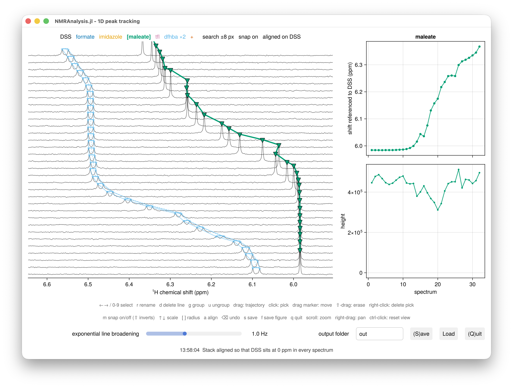
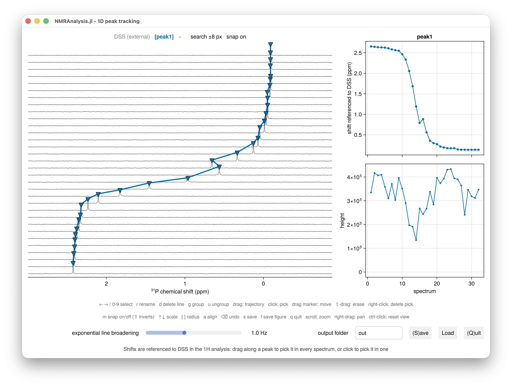

# Peak tracking

`peaktrack1d` follows the chemical shifts of peaks across a series of 1D spectra, such as a
pH series or a titration. You pick each peak by dragging along its path through a stack of
the spectra. A peak can be a singlet or a multiplet, and one peak is the chemical shift
reference. Nothing is fitted: the shifts are the result.



## Usage

```julia
using NMRAnalysis
peaktrack1d(11:16)
peaktrack1d(11:16; coordinates="pH" => [5.5, 6.0, 6.5, 7.0, 7.5, 8.0])
```

`peaktrack1d` processes the raw data itself: it phases each experiment automatically, and a
slider under the plot sets the line broadening. Pass `process=false` to use the spectra
processed in TopSpin instead.

| Keyword | Meaning |
|---|---|
| `coordinates` | What distinguishes the spectra, such as `"pH" => [...]`, for the plots and tables |
| `process` | `false` to use the processed spectra |
| `phase` | `:auto` (default), `:pdata`, a vector of `(p0, p1)` in degrees, or a saved `processing.csv` |
| `reference` | The name of the reference peak, or a ¹H analysis to reference other nuclei to DSS |
| `peaklist` | Picks to start from: a saved `peaklist.csv`, or an earlier analysis |

### Example

A ¹⁹F titration of an SH3 domain:

```julia
peaktrack1d(example("1d_19f_titration_sh3"))
```

```@setup peaktrack1d
using NMRAnalysis
NMRAnalysis.screenshot("peaktrack1d.png") do
    saved = Main.savedanalysis("1d_19f_titration_sh3")
    isnothing(saved) ? peaktrack1d(example("1d_19f_titration_sh3")) : reopen(saved)
end
```


## Pick peaks

The status line above the plot lists the peaks: the reference first, the current peak in
brackets, and `+`, a slot for a new peak, at the end.

1. Select a peak with `←` `→` or the number keys, or move to `+` for a new one.
2. Drag along the peak's path through the stack. In each spectrum the brush crosses, the
   tallest point in the shaded band is picked.
3. Correct single spectra: click to pick, drag a marker to move it, right-click to delete
   it.
4. Press `r` to name the peak.

If a neighbouring peak is picked instead, narrow the brush with `[`. To place picks by hand
where two lines overlap, press `m` to turn snapping off.

To pick a multiplet, pick each line as its own peak, then press `g` on the second line and
click a marker of the first. Its shift is the mean of its lines.

The panel on the right plots the current peak's shift and height against your coordinate.

## Reference the shifts

The first peak, in black, is the reference. Pick it like any other, and press `a` to align
the spectra on it. Alignment only changes the display: the output gives both measured and
referenced shifts.

To reference ¹⁹F or ³¹P to DSS, analyse the ¹H spectra with DSS picked, and pass that
analysis as the reference. The shifts are then on the IUPAC unified scale, through Ξ:

```julia
h = peaktrack1d(11:30)
f = peaktrack1d(31:50; reference=h)
```

Give the spectra in matching order: the first ¹⁹F spectrum is referenced with the first ¹H
spectrum.



## Keys

| Key | Action |
|---|---|
| `←` `→` | Previous or next line |
| `0` to `9` | Select a peak; `0` is the reference |
| `r` | Rename the current peak |
| `g`, then click | Join the clicked line's peak to the current one |
| `u` | Move the current line into a peak of its own |
| `d` | Delete the current line |
| `a` | Align the spectra to the reference |
| `m` | Snapping on or off; `Shift` inverts it while held |
| `↑` `↓` | Vertical scale |
| `[` `]` | Brush and search radius |
| `Backspace` | Undo |
| `s` | Save |
| `f` | Save a figure of the region shown |
| `q` | Quit |

Scroll to zoom, right-drag to pan, and ctrl-click to reset the view.

## Output

**Save** writes to the folder named beside it:

| File | Contents |
|---|---|
| `summary.txt` | The processing, the reference and each peak's range of shifts |
| `shifts.csv` | The shift of every line, one row per spectrum and one column per line |
| `referencedshifts.csv` | The same, referenced |
| `heights.csv` | The height of every line |
| `series.csv` | Every line in every spectrum, in one table |
| `peaklist.csv` | The picks, for **Load** and `peaklist` |
| `processing.csv` | The phases and line broadening used |
| `stack.pdf`, `peaks/` | The stack, and a plot of each peak's shift |

`f` saves a publication figure of the region shown. For the analysis `p` that `peaktrack1d`
returns, `clipboard(p)` copies the shifts, ready to paste into a spreadsheet.
