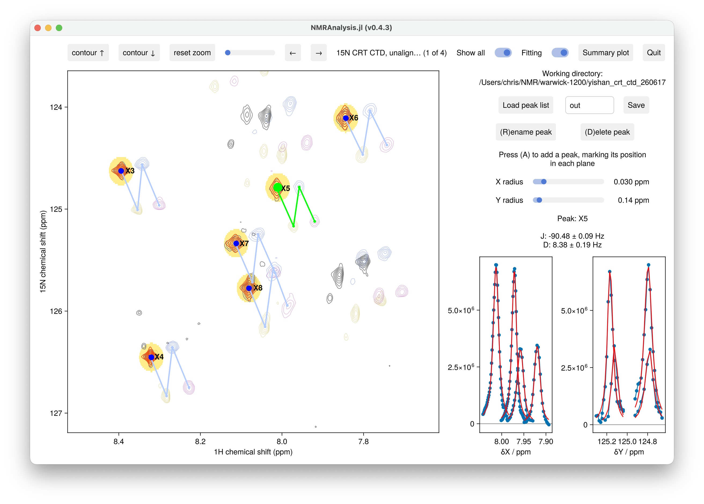

# RDCs and J-couplings

`rdc2d` measures one-bond scalar couplings J and residual dipolar couplings D from the
splitting between the two components of a doublet, recorded in an isotropic and an aligned
sample:

```math
J = s\,\Delta_\text{iso}, \qquad J + D = s\,\Delta_\text{aligned},
```

where ``\Delta`` is the separation of the two components in Hz, and the scale ``s`` is 1
for IPAP spectra, where the separation is the full coupling, and 0.5 for an HSQC and TROSY
pair.



## Usage

Give the two component spectra of the isotropic sample, then those of the aligned sample:

```julia
using NMRAnalysis
rdc2d([1, 2], [11, 12])
rdc2d([1, 2], [11, 12]; scale=0.5)    # HSQC and TROSY
```

| Keyword | Meaning |
|---|---|
| `scale` | 1 for IPAP (default), 0.5 for HSQC and TROSY |
| `coupling` | The dimension the splitting is in, `:F1` or `:F2`. Defaults to the heteronucleus |

Peaks are added as in [Peak tracking](peaktracking.md), marking the peak in each of the four
spectra.

The sign is flipped for ¹⁵N, which has a negative gyromagnetic ratio, so ¹J(NH) is about
−93 Hz. Give the components in the same order for both samples. If J has the wrong sign,
swap both pairs.

## Output

**Save** writes these parameters for each peak to `results.csv`, a plot of each peak's fit
to `peaks/`, and a summary plot against residue number to `summary.pdf`. See
[Output](overview.md#Output) for the other files.

| Parameter | Meaning |
|---|---|
| `J` | Scalar coupling, Hz |
| `D` | Residual dipolar coupling, Hz |
